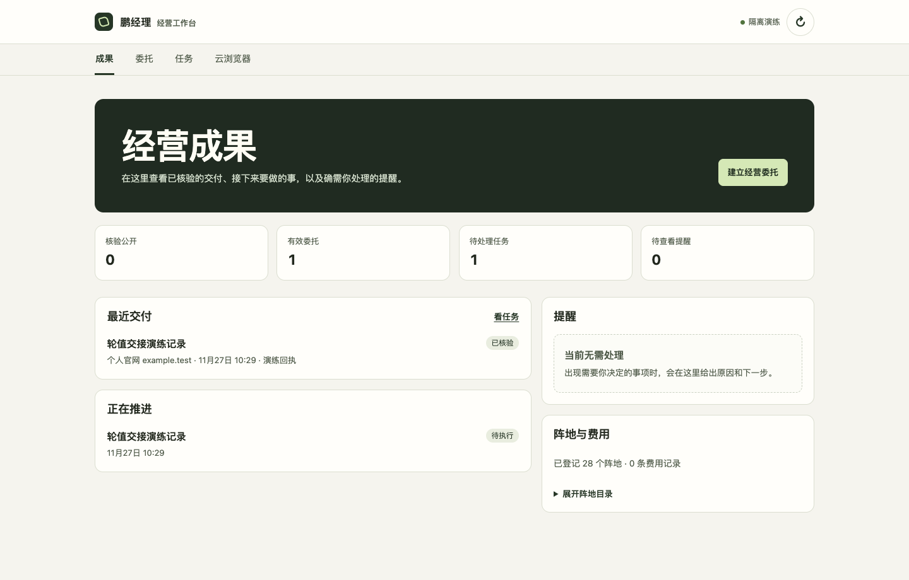

# 鹏经理 BOT 版 · PengManager BOT

鹏经理是一个可自托管的内容经营助手。你在手机或电脑上把目标、可信信源、账号、预算和交付期限交给它。服务在云端持续收线索、安排研究和制作、跟进审核，并保存每一步的依据。关掉浏览器，服务继续运行。下次打开工作台，可以看到哪项已经交付、哪项卡住、哪些事情需要本人处理。

举个例子，你授权它跟踪某个开源项目的正式公告并纠正官网旧文。原公告更新后，如果新事实通过审核，而且同一来源只对应一篇当前公开旧文，它可以准备修订稿并交给独立审核。成品和配图通过审核、改稿授权仍然有效时，它在原地址更新文章，并回读正文和配图。配置好固定问题和采样预算后，它在发布后的第 1、3、7 天复测，记录哪些回答实际引用了文章。



## 先在本机看一遍

使用独立安装的 **Node.js 24** 和仓库锁定的 **pnpm 11.25.0**。演练使用本地 SQLite 和合成材料。

```sh
git clone https://github.com/geniusdapeng-collab/pengmanager-bot.git
cd pengmanager-bot
pnpm install --frozen-lockfile
node scripts/bot-admin.mjs demo
```

打开终端显示的工作台地址，默认是 **http://127.0.0.1:4320/bot/** 。登录密码在终端指出的私有数据目录中。先看演练委托和渠道回执，再用自己的话写下经营目标。生成草案后可以核对信源、已审事实、频次和交付时限，预算和代办账号由你勾选签发。需要在脚本里检查整条演练时，运行 `node scripts/bot-admin.mjs demo --once`。从空工作台开始可直接运行 `pnpm start`。演练和生产使用不同数据库，演练记录带有 `fixture` 标记。

## 它怎样完成一次委托

| 环节 | 鹏经理实际做什么 | 主人能核对什么 |
| --- | --- | --- |
| 发现 | 按委托轮询 JSON Feed 或公开 GitHub Release，接受本人提交的线索。相同事件重复送达时回到原任务。 | 信源、接收时间、任务 ID、判断依据 |
| 判断 | 把已核事实、题目和既有文章交给模型，判断写新稿、修旧稿、延后或舍弃。账号和预算的最终检查由服务执行。 | 选题决定、所用证据、28 个阵地的处理理由 |
| 制作 | 原生内容总控分步研究、写稿、审核。官网稿使用已审核的插图及来源。更改正文或资产后重新核对成品。 | 原生作业、版本、文件摘要、审核人和签章依据 |
| 交付 | 官网服务核对原稿版本再激活。DEV 连接器走 Forem 官方 API，核对账号和成品。本人确认的场景保留独立交接记录。 | 实际发布位置、公开可见性、独立回读、待对账动作 |
| 跟踪 | 运行发布前基线和 T+1／3／7 复测，保留样本和失败原因。周报保留到期未达项。 | 原始问题、样本、有效配对数、引用、费用和人工介入 |
| 续办 | 持久队列用租约和代次交接工作。提交回执或计费结果丢失时保留原操作号，等待核对。 | 重试、撤权、未知费用和未达承诺 |

**渠道能力随账号、内容形态和权限变化。** 目录包含 1 个自有官网和 27 个外站，各有原生岗位。首版的自动写入路径是自有官网和已验证的 DEV 技术账号。知乎回答和文章有专门的适配与本人交接。其余阵地逐项输出可制作的方案、所需材料、人工步骤或阻塞原因。只有真实可见性回读取证后，生产报表才增加公开交付数。

## 部署到云主机

先为单个所有者、单个项目准备一个常驻服务和 HTTPS 入口。SQLite 及原生内容存放在私有数据盘，外部写入与费用意图另存一份到独立持久卷。生产模式启动时检查两者的设备号。

- **所有者**配置管理员密码哈希、HTTPS 地址和数据目录。服务端轮询、定时唤醒、任务队列与周报都独立于浏览器会话运行。
- **模型和预算**使用显式模型凭据和运营者的有效价目。发请求前占额，按原始用量与该价目结算。价格证明、计费币种和不确定金额可以分别核对。
- **发布账号**登记原生账号身份、目标位置、规则证据及到期时间，再签发有限委托。每次自动提交都需要通过对确切成品和当前授权的最后检查。
- **失联告警**可以在另一台主机部署独立探针。主服务失去心跳或拒绝请求时，探针另路报告故障和恢复。
- **主动联系**支持所有者配置的 HTTPS 通知接收端。投递使用固定通知 ID，接收端返回同一 ID 和送达回执，失败按退避节奏重试。工作台保留通知历史。
- **云浏览器**可按需部署在独立 Linux 工位。本人通过同源 HTTPS 页面领取短时控制权，处理登录、验证或原生确认，交还后连接结束。
- **媒体**随源提供 FFmpeg 后期代码、字幕与封面组件。外部视频生成、付费素材和专业渲染工位由部署者按许可接入。图文 BOT 无需启动完整视频桌面环境。

完整的账号准备、配置、启动、健康探针、原生材料交接、恢复和对账步骤见[生产运行手册](docs/OPERATIONS.md)。远程工位的组件、权限和配置样例见[云浏览器部署](deploy/bot-browser/README.md)。

## 验证

```sh
pnpm --dir deploy/bot-browser install --frozen-lockfile --ignore-scripts --prod
pnpm test
node scripts/bot-admin.mjs demo --once
```

`pnpm test` 运行 BOT、原生回归和公开包检查。媒体回归需要 FFmpeg 与 ffprobe 可执行文件。测试覆盖同源登录和权限、事件去重、重启和撤权、预算保留、官网回读、DEV 响应不明、本人交接、GEO 配对和压缩时钟下的跨周续办。部署者应另行在自己的账号上记录生产送达、模型质量及连续运行时长。生产结果能追到原始材料，不会与本地演练合并计数。

用同一组账号和预算做判断盲评，可运行 `node scripts/bot-evaluate.mjs --out var/evaluation/fixture`。每个案例保留输入、决策、无权限时的动作及评分依据。真实模型盲评有独立的预算和密封题包要求。见[盲评方法](docs/BOT-EVALUATION.md)与[开源包及可选依赖清单](docs/PUBLIC-DISTRIBUTION.md)。

## 代码导航

| 路径 | 内容 |
| --- | --- |
| [src/bot/host.mjs](src/bot/host.mjs) · [daemon.mjs](src/bot/daemon.mjs) | 进程入口、原生服务装配、信源轮询和独立岗位执行 |
| [src/bot/core.mjs](src/bot/core.mjs) · [core-effects.mjs](src/bot/core-effects.mjs) | 委托、任务、工作租约、授权放行、费用和恢复 |
| [src/bot/operations.mjs](src/bot/operations.mjs) · [operations-policy.mjs](src/bot/operations-policy.mjs) | 选题、渠道策略、原生交接和动作执行 |
| [src/bot/operations-geo.mjs](src/bot/operations-geo.mjs) · [learning.mjs](src/bot/learning.mjs) | 原始样本配对、有限巡检频率试验和回退 |
| [src/bot/meter.mjs](src/bot/meter.mjs) · [scorecard.mjs](src/bot/scorecard.mjs) | 按次用量依据、到期分母、按时自主交付率 |
| [public/bot](public/bot) · [scripts/bot-admin.mjs](scripts/bot-admin.mjs) | 手机与桌面工作台、所有者部署和运维工具 |
| [tests](tests) · [deploy](deploy) | 可重跑的测试、服务及工位部署样例 |

## 许可证

项目采用 Apache License 2.0。随附分词器、字体和上游组件保留各自的授权与署名。发布者自行管理账号和内容素材的使用许可。详见 [LICENSE](LICENSE) 与 [NOTICE](NOTICE)。
